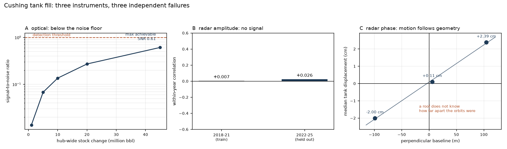

# Harvest Surprise

> Can free satellite data measure something real about the physical economy -
> and does that measurement carry information the market does not already have?

Started as a corn-yield project, then widened into a feasibility study of every
signal proposed in the comments of a satellite-trading video. **Read
[`FINAL_REPORT.md`](FINAL_REPORT.md) first** - it is the whole result in one
document.

## Where this came from

This project exists because of a YouTube video: **["Using Satellite Photos to
Trade Stocks" by LosingLoonies](https://youtu.be/VJm9BBJwMDY)**. In it he tries to
measure how full the oil tanks at Cushing are, from the crescent shadow of the
floating roofs in Sentinel-2 imagery, and concludes it does not make money. The
comments underneath - 535 of them, 337 top-level - were the actual starting point:
people proposing better sensors, other domains, and every reason the idea could
not work. `research/comments_all.csv` is that corpus.

Two things here are direct replies to that video. **Section 2.6 of the report
rebuilds his own tank project** more carefully than he could with 15 images - and
reaches his conclusion for reasons he did not have. Everything else came from
following the comments outward, especially the agricultural-yield thread that
became the reservoir and rice work.

The original author's framing of the problem was right, and the debt is worth
stating plainly: without that video and its comment section, none of this exists.

Data sources: Microsoft Planetary Computer (Sentinel-1/2, MODIS), NASA/ASF HyP3,
USDA NASS Quick Stats and WASDE, US EIA, California CDEC, NASA POWER, and
OpenStreetMap.

## The short version

Four signals were built and tested; two survived, two did not.

| signal | verdict | evidence |
|---|---|---|
| **Reservoir storage** from Sentinel-2 water extent | **works** | Spearman **0.66-0.93** vs daily CDEC gauges; level error cut **15-62%** against a mean baseline |
| **Water -> rice acreage** | **works** | elasticity **+0.41** (t 5.2, n=36), survives a price control, placebo insignificant |
| Corn yield from free data | fails | does not beat the USDA forecast; the disagreement is not tradable (+7.6%/yr vs +9.7% buy-and-hold) |
| **Cushing tank fill** (the video's own project) | **fails, three ways** | optical SNR 0.27; radar amplitude +0.03 held out; InSAR phase coherent (0.64) but motionless |

The two failures are the more interesting half, because each has a *reason*
rather than a shrug:

- **Optical tank fill is arithmetically impossible at 10 m.** A 20 Mbbl hub-wide
  move changes roof brightness by 2.4% against a measured 8.9% noise floor. SNR 2
  would need 147 Mbbl - 307% of Cushing's working capacity. Across four hubs the
  noise floor never drops below 8.9%.
- **Radar phase sees the tank but not the oil.** Coherence over the roofs is 0.64,
  so the targets are excellent. The measured displacement is a twentieth of what
  the inventories require, scales with the perpendicular baseline (a geometric
  artefact), and spans two centimetres across every tank. The reason is
  resolution: HyP3's `looks` are not a metre grid, so those products are **80 m**,
  and its finest option, `10x2`, is **40 m** - a 30-60 m tank is smaller than one
  pixel. The same pair gives +0.11 cm at 80 m and +6.72 cm at 40 m.

`resolution_filter.py` settles the physics questions in advance; `tank_detectability.py`
does the same for tank fill.



*Each instrument fails for its own reason: optical never clears the noise floor,
radar amplitude correlates with nothing, radar phase tracks the orbit baseline.
Built by `analysis/tank_summary_figure.py`.*

## Query it

```powershell
uvicorn serve.app:app --port 8000     # then open http://127.0.0.1:8000/docs
```

Four read-only endpoints over the artefacts: `/health`, `/water/{year}` (top H3
cells by reservoir access), `/county/{name}` (acreage series), `/reservoirs`
(validation scores). Smoke-tested with FastAPI's TestClient, no server needed.

## Run it

```powershell
pip install -r requirements.txt   # tests + API; the ingest stack needs more
python hsp.py ingest      # NASS, WASDE, futures, weather, CDEC  (~15 min)
python hsp.py measure     # Sentinel-2 reservoir loop + validation (~40 min)
python hsp.py analyse     # gates 0-2, water-rice, chain          (~2 min)
python hsp.py test        # data integrity checks
python -m pytest tests -q # 27 assertions on the claims
```

`hsp.py` stops at the first failing stage. The Cushing and InSAR analyses are
separate: they need network access and, for the radar work, an ASF login
(`analysis/cushing_*.py`, `analysis/insar_pairs.py`).

## Layout

```
FINAL_REPORT.md      the whole study, one document
serve/app.py         read-only API over the artefacts (FastAPI)
docs/DQ.md           data-quality catalogue, counted per raw table
docs/corn-report.md  the phase-1 corn study, archived
hsp.py               pipeline runner
ingest/              nass, wasde, prices, weather, cdec  (+ README)
analysis/            gate0/1/2, reservoir_v2(+validate), water_rice,
                     rice_surprise, chain, h3_water, resolution_filter,
                     cushing_tanks, cushing_per_tank, cushing_sar,
                     tank_detectability, hub_noise, insar_pairs
tests/               27 assertions on the claims, not on helpers
spike/               the original 25-year MODIS pull
research/            comments corpus, CANDIDATES, FEASIBILITY, RESERVOIR,
                     WATER, CUSHING, INSAR
data/raw/            immutable pulls (gitignored)
data/processed/      every number in the report + run logs + figures
```

## What is not done

- **The water-to-power link is blocked.** CAISO rejects both hub node identifiers
  and its node-list queries, and returns "no data" for every window before 2024,
  so there is no electricity price series to test against.
- **The satellite-to-economics chain is closed by error propagation**
  (5.2% storage error -> 2.1% acreage error), not by an out-of-sample run on real
  years.
- **Full-resolution SLC interferometry over the tanks is untested.** It is the one
  experiment that could overturn the InSAR conclusion, and it needs a custom
  interferogram rather than a HyP3 product.

All three are stated in `FINAL_REPORT.md` section 5.

## Licence and data

Code is MIT (see `LICENSE`). The datasets come from the sources listed above and stay under their
providers' terms. The comment corpus in `research/` is the public comment section of the video linked
above: commenter handles are replaced by stable pseudonyms (`@user-xxxxxx`; the video's creator is credited
by name), and the raw yt-dlp dump is not included. `research/build_corpus.py` documents how to fetch it.
