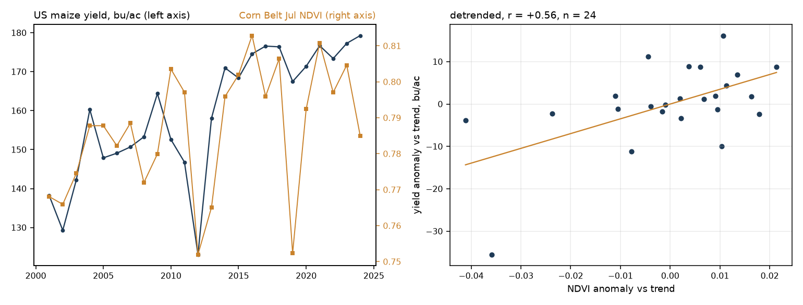

# Spike results — 2026-11-11

What this is: a feasibility check on the data path and on one very crude signal. It is
**not** an evaluation of the project, and it is not evidence of tradability. Everything
below was produced by the scripts in this folder and can be re-run.

## What ran

| Step | Command | Result |
|---|---|---|
| yield series | `spike/yields_owid.py` | 31 rows, 1995–2025, US national maize yield in bu/ac |
| NDVI pull | `powershell -File spike/run_years.ps1` | 25 years × 12 composites over the Corn Belt, ~45 s/year, no auth, no cost |
| join + model | `spike/analyse.py` | 24 overlapping years (2025 dropped: only one composite was returned, the June 26 pass) |
| robustness | `spike/stats.py` | below |

The satellite input is MODIS MOD13Q1 250 m 16-day NDVI, Terra only, three composites per
season (late June, mid July, late July), averaged over a fixed box covering IA, IL, IN,
NE, MN, MO, KS, SD and WI. The yield series is OWID/FAO national maize yield; its 2023
and 2024 values match NASS exactly (177.3, 179.3 bu/ac).

## The numbers

| | |
|---|---|
| n | 24 years (2001–2024) |
| corr(NDVI, yield), levels | **+0.637** |
| corr, both detrended (quadratic in year) | **+0.559** (p = 0.0045) |
| Spearman, detrended | +0.413 |
| slope | **+349 bu/ac per 1.0 NDVI** (se 110) — i.e. a +0.01 NDVI anomaly ≈ **+3.5 bu/ac** |
| R² | 0.31 |
| LOO RMSE, trend only | 10.25 bu/ac |
| LOO RMSE, trend + NDVI | **9.82 bu/ac** (a 4 % improvement) |
| residual sd | 8.35 bu/ac |
| yield sd over the sample | 16.2 bu/ac |

So a single coarse greenness number, a fixed box, no crop mask and no weather, gets about
a third of the detrended variance and improves a naive trend forecast by 0.4 bu/ac. That
is roughly what the published literature would lead you to expect, which is a good sign
that the pipeline is not broken.

## The number that matters most

**Drop 2012 and the correlation collapses from 0.559 to 0.334 (p = 0.12).**

The relationship over 24 years is, to a first approximation, one drought. That is the
single most useful output of this spike, and it is exactly the failure mode the brief
predicts: 24 observations, one of which carries almost all the information, and a model
that is scored on the average year rather than on the year that pays.

## Where it fails, and why that is interesting

| Year | Yield anomaly (bu/ac) | NDVI anomaly | Model residual | What happened |
|---|---|---|---|---|
| 2012 | −35.5 | −0.036 | **−23.0** | the drought. NDVI moved the right way but *understated* it by a factor of ~4; any model built on greenness alone would have massively over-predicted 2012 |
| 2011 | −10.0 | +0.010 | −13.6 | canopy looked normal; the damage was July heat during grain fill, after the composites that dominate this average |
| 2019 | −3.8 | −0.041 | +4.3 | the *worst* canopy in the sample and only a mild yield loss — because 2019's loss was **acreage** (record prevented planting), not yield per acre on the acres that were harvested |

Those three rows are the argument for the rest of the project:

1. Greenness saturates and understates a real drought (2012) — so heat and water-balance
   variables are not a nice-to-have, they are the signal.
2. Greenness misses damage that happens after the observation window (2011) — so the
   feature has to be phenology-anchored, not calendar-anchored.
3. Greenness conflates a bad crop with a small crop (2019) — so the target has to be
   separated from acreage, and the national yield number is the wrong target when
   prevented planting is in play.

## What this proves

- The free data path works end to end: STAC → windowed COG reads → a per-year series, on
  a laptop, with no account, no key and no download budget, at ~45 s per year of MODIS.
- The signal is present at the magnitude the literature implies, so the measurement side
  of the brief is not wishful thinking.
- The pipeline is small: three scripts, a few hundred lines, a 2 MB CSV output.

## What this does **not** prove

- Nothing about tradability. There is no price data in this analysis at all.
- Nothing about accuracy against USDA, or about the *surprise* — a correlation with the
  yield level is not a correlation with the report revision.
- Nothing out-of-sample in any meaningful sense: the detrend is fitted on the whole
  sample, the box is fixed ex post, and the three composites were chosen with hindsight.
- No crop mask, no cloud-QA filter beyond the composite, no SAR, no weather, no
  point-in-time handling. Every one of those is Gate 1 work.

## Honest caveats on the numbers

- The yield series is FAO-derived, not NASS. It matches NASS in 2023–2024 but will
  diverge elsewhere; the correlation would move somewhat with the official series.
- The NDVI box includes forest, urban and soy. A crop mask would raise the correlation
  and would also be the honest way to do it.
- Tiles overlap at the AOI edge and are combined by valid-pixel count; the northern
  sliver is double-counted.
- 2025 is excluded (one composite only), so the sample is 2001–2024.
- The p-value assumes independent years. They are not: 2012 dominates, and neighbouring
  years share weather regimes. The block bootstrap in Gate 2 exists for this reason.

## Figure

Left: national yield and Corn Belt July NDVI, 2001–2024. Right: both detrended, with the
OLS fit. The two points that decide the fit are 2012 (bottom left) and the cluster of
good years around 2016–2021.
